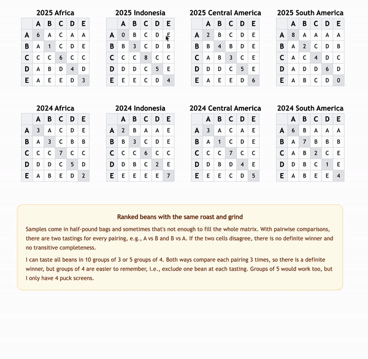
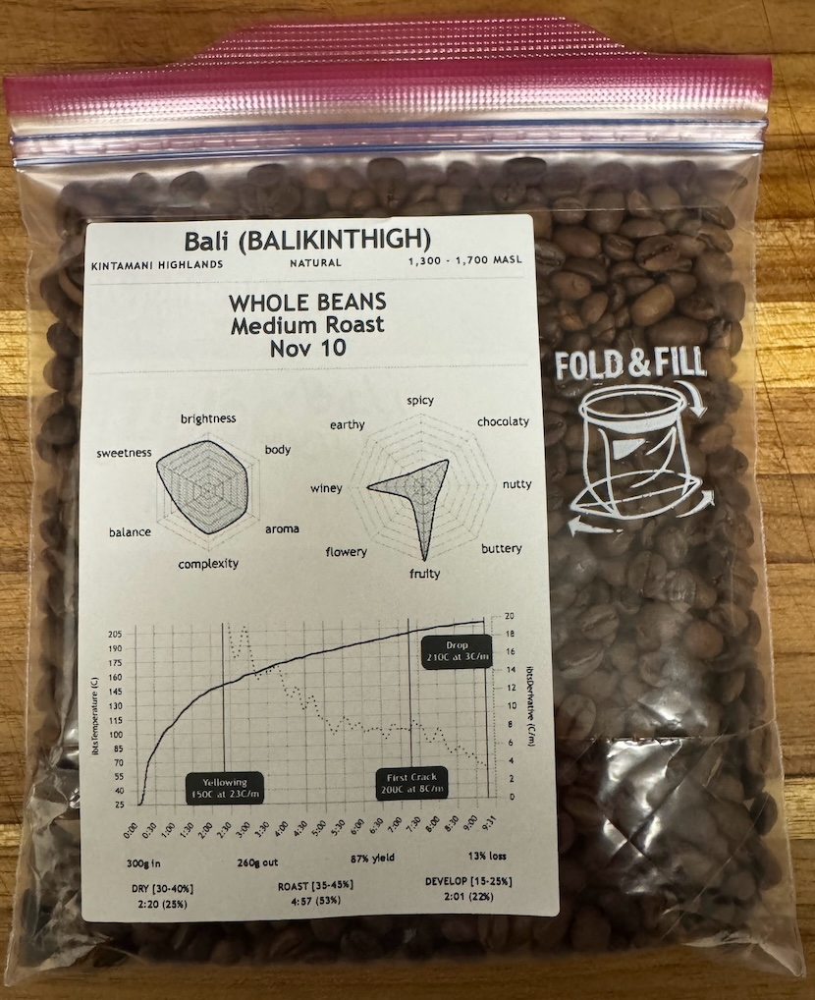

# Coffee

<!-- 830px wide -->




# Roast Labels (Local only)
```
ROASTWORLD_TOKEN="..." npm run start
ROAST_ID="..."
open http://localhost:8080/label/$ROAST_ID
```

# NOTE
Label grid only shows up under "More Settings" > "Print using system dialog".